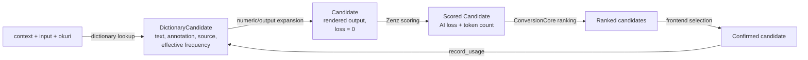

# SKK Zenz data flow

This diagram describes the runtime data flow from the fcitx5 frontend through
candidate generation and asynchronous AI scoring to candidate confirmation.
Solid arrows form the main request/response path. Dashed arrows represent
polling or implementations intended for offline simulation.

```mermaid
flowchart LR
    subgraph frontend["fcitx5 frontend"]
        fcitx["fcitx5<br/>key events / surrounding text"]
        adapter["SkkZenzEngine<br/><code>fcitx5_adapter.cpp</code>"]
        ffi["Rust C ABI bridge<br/><code>fcitx5-addon/src/bridge</code>"]

        fcitx -->|"key, context,<br/>candidate index"| adapter
        adapter -->|"C ABI calls"| ffi
        ffi -->|"InputEvent"| backend
        ffi -->|"InputUpdate"| adapter
        adapter -->|"preedit, candidate window,<br/>committed text"| fcitx
    end

    subgraph interactive["interactive backend"]
        backend["Backend<br/>IME orchestration"]
        state["InputState / state machine<br/>mode, context, preedit,<br/>selection cursor"]
        active["ActiveRerank<br/>generation, progress,<br/>selection preservation"]

        backend <-->|"state transitions"| state
        backend <-->|"asynchronous rerank state"| active
    end

    subgraph conversion["shared conversion core"]
        core["ConversionCore&lt;U&gt;<br/>candidate generation and ranking"]
        numeric["NumericInput<br/>numeric key expansion"]
        usertrait["UserDictionary<br/>lookup_at / record_usage"]
        sqliteimpl["SqliteUserDictionary"]
        memoryimpl["MemoryUserDictionary<br/>simulation / tests"]
        systemdict["SkkFileDictionary[]"]

        core -->|"lookup / reconversion"| numeric
        core -->|"lookup_at(timestamp)"| usertrait
        core -->|"dictionary lookup"| systemdict
        usertrait --> sqliteimpl
        usertrait -.->|"alternative U"| memoryimpl
    end

    subgraph scoring["AI scoring"]
        worker["ZenzWorker<br/>worker thread and channels"]
        scorer["ZenzScorer<br/>prepare / score"]
        model["llama.cpp model"]

        worker -->|"context, input, output"| scorer
        scorer -->|"token inference"| model
        model -->|"loss / token count"| scorer
    end

    subgraph persistence["persistent data"]
        sqlite[("user.sqlite3<br/>candidate + frequency + updated_at")]
        skkfiles[("system SKK dictionaries")]
        history[("conversion_history.csv")]
        modelfile[("GGUF model")]

        sqliteimpl <-->|"read usage state<br/>decay then +1 on use"| sqlite
        skkfiles --> systemdict
        model <-->|"model weights"| modelfile
    end

    state -->|"conversion request<br/>context, input, okuri"| backend
    backend -->|"input, okuri, current time"| core
    core -->|"candidates<br/>effective frequency in recency"| backend

    backend -->|"candidates ordered without AI loss"| worker
    worker -->|"initial scored candidates"| backend
    worker -.->|"RerankUpdate for remaining candidates"| backend
    ffi -.->|"poll_rerank()"| backend

    backend -->|"rerank using source,<br/>frequency and AI loss"| core
    core -->|"ordered candidates"| backend
    backend -->|"InputUpdate"| ffi

    ffi -->|"selected candidate index"| backend
    backend -->|"confirmed Candidate"| core
    core -->|"record_usage(timestamp)"| usertrait
    backend -->|"context, input, okuri, text"| history
    backend -->|"committed output + updated context"| ffi

    classDef frontend fill:#e8f1ff,stroke:#4472c4,color:#111;
    classDef backend fill:#fff2cc,stroke:#bf9000,color:#111;
    classDef core fill:#e2f0d9,stroke:#548235,color:#111;
    classDef scoring fill:#fce4d6,stroke:#c65911,color:#111;
    classDef storage fill:#ededed,stroke:#666,color:#111;

    class fcitx,adapter,ffi frontend;
    class backend,state,active backend;
    class core,numeric,usertrait,sqliteimpl,memoryimpl,systemdict core;
    class worker,scorer,model scoring;
    class sqlite,skkfiles,history,modelfile storage;
```

## Candidate data at each stage

