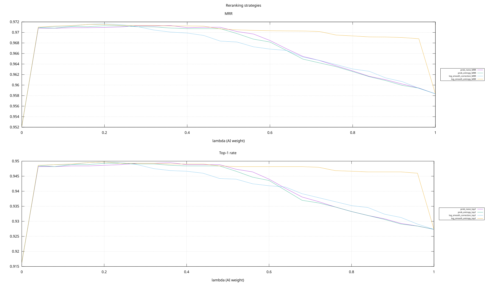
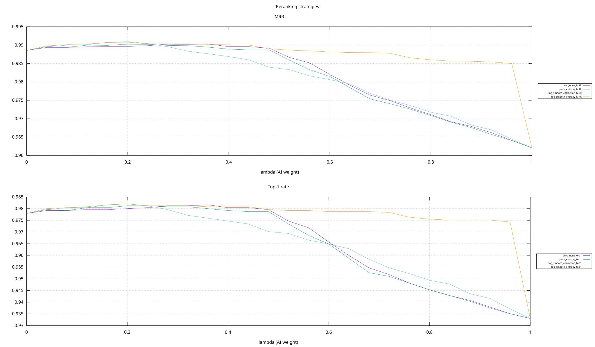

# 候補の並べ替えについて

このアプリの性能を決める部分だとおもっている

## 前提

- オリジナルのSKKはMRUをもとに候補を並べている
  - 多くの場合はこれで十分。分布の偏りのため
  - 一部、一般的な語で衝突することがある
  - 本実装では、オリジナルSKKから改変し、送りがなの母音を使用した候補絞り込み (母音を含めた送りがなでMRUを計測) をしている
- Zenzでは候補ごとにloss (-logprob)を計算することができ、候補をソートするのに使える
  - 学習データの偏り、ユーザの好み、頻出する固有名詞、などによって、最適でない候補が最上位に来ることがある

Zenzによる評価値と、ユーザーの過去の入力傾向(frequency)を混成してソートを行いたい。
一定以上のfrequency差があるときは、AI評価にかかわらずfrequencyを優先する、という動作になると嬉しい

## 結論


$$
\begin{align*}
  \mathrm{score} &= \lambda \cdot \mathrm{score}_\mathrm{ai} + (1-\lambda) \cdot \mathrm{score}_\mathrm{user}, \\
  \mathrm{score}_\mathrm{ai} &= \log(P_\mathrm{ai}), \\
  \mathrm{score}_\mathrm{user} &= g \cdot P_\mathrm{user} + (1-g) \cdot \frac{1}{\mathrm{count\ of\ candidates}}, \\
  g &= H(P_\mathrm{user}), \\
  \lambda &\approx 0.2 \\
\end{align*}
$$

## (参考) 調査録

作者(ふわわあ)の約1週間の変換履歴データ、合計約4.5k件を使用して統計をとった。

### スコア合成

frequencyは時間経過による傾向変化に対応するため、指数減衰を持たせていることに注意

AI評価値はTransformerではlogprobの形で得られ、これはfrequencyと同じ次元の指標として使える。
したがって、AIによる評価値と、ユーザー履歴による評価値を、線形和をとってソートすることにした

それぞれ、候補集合全体で和が1になるよう正規化したもの($P_\mathrm{ai}, P_\mathrm{user}$)を使用する。

$$ \mathrm{score} = \lambda \cdot \mathrm{score}_\mathrm{ai} + (1-\lambda) \cdot \mathrm{score}_\mathrm{user} $$

$\mathrm{score}_\mathrm{ai}, \mathrm{score}_\mathrm{user}$に、$P_\mathrm{ai}, P_\mathrm{user}$を使う方法と、logprob空間に写して$\log P_\mathrm{ai}, \log P_\mathrm{user}$を使う方法が考えられる。\
→logのほうが性能がよかった 頻度の比を評価するほうがいいみたい

$\mathrm{score}_\mathrm{user} = g \cdot P_\mathrm{user} + (1-g) / N$として、一様分布と「混ぜ」、user probabilityの使用率を変化させられるようにする。
frequencyが0に近いときにlogが-infに吹っ飛ぶ問題があって、まともな線形和を得るために細工してやる必要があったため。\
$g$の候補はいくつかあって、

- 固定値
- $N/(N+k)$ (frequencyが極端に小さいときに暴れにくくする意図)
- sigmoid confidence (上位2件の比をsigmoidする)
- entropy confidence (全件のprobのエントロピーを使用する)

→entropyが性能がよかった、sigmoidもよいが、パラメタ調整が不要なほうが望ましい。



↑4種の方針の比較、$\lambda$を可変させてプロット
$\lambda=0$がbaseline, 旧来のSKKに(おおよそ)対応する。
MRR (Mean Reciprocal Rank)は、baselineで0.952であったものが、最大0.97まで上昇する。

> λ=0の直後に精度が急増したのは、recencyだけでは区別できない候補を少量のAI項がtie breakしたためと考えられる。


↑初登場の変換候補を使用するケースを除外、frequencyが効くものだけにしたもの

上に凸な形が見えてうれしい

logprob, smoothing with entropy confidence, $\lambda \approx 0.2$ が最善と判断した。\
このときのMRRは0.971, top-1 rateは0.95 \
初回のエントリを除くと(frequencyが少なからず意味のある値をとるとき)それぞれ0.99, 0.98。


### AI評価値のlength equalize

transformerのlogprobは各tokenの和として出るので、長い結果文字列ほど不利になる。
$\mathrm{count}^\alpha$を係数としてやって、長さによる差を埋めることを検討した

```
normalization alpha  count      MRR  top1_rate improved worsened unchanged
none           0.00   4555 0.958339   0.927333        0        0      4555
token          0.25   4555 0.957459   0.926235        3        8      4544
token          0.50   4555 0.955029   0.923600        5       22      4528
token          0.75   4555 0.952445   0.920307        6       38      4511
token          1.00   4555 0.950504   0.917673        7       51      4497
character      0.25   4555 0.957481   0.926235        3        8      4544
character      0.50   4555 0.955392   0.923820        5       21      4529
character      0.75   4555 0.954409   0.922942        6       26      4523
character      1.00   4555 0.953789   0.922064        7       31      4517
```

αの増加に伴ってworsenedが単調に増える一方、improvedはほとんど増えなかった。
正解token数別では、長い候補に多少の改善が見られた。

一般に短いものが頻度が高く、正解である確率が高い。この性質がモデル出力や学習データの偏りよりも強い可能性。

> 総log probabilityに含まれる短い系列への選好は、このSKK候補集合では単なる不要なbiasではなく、有用なlength priorとして働いている可能性が高い。補正前から正解3+ tokenのtop-1は高く、想定していた「長い正解候補が不当に落とされている」問題も全体精度へ影響するほど存在しなかった。


確率評価としては正しくないが、実験からはlength equalizeを入れないほうが良い結果が得られることがわかったため、この正規化を入れないことにした。

